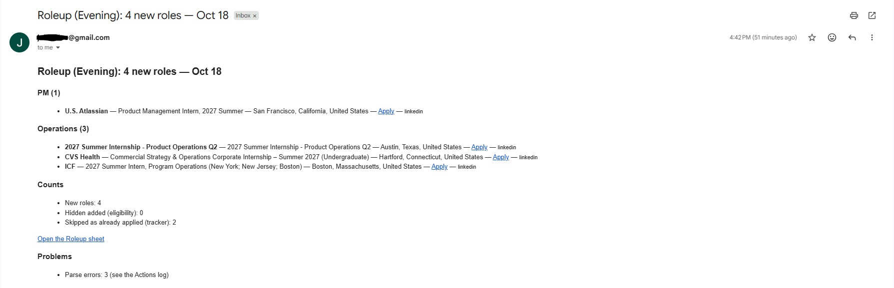
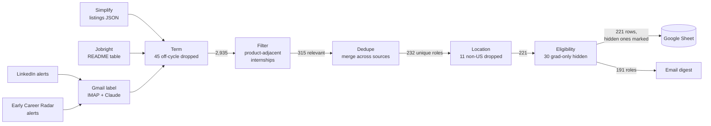
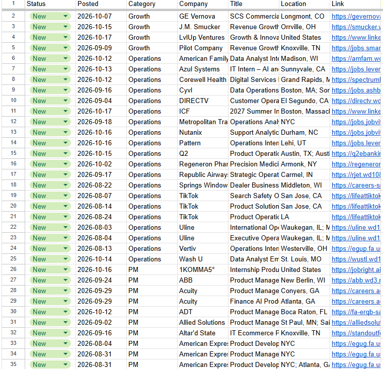

# Roleup

**Roleup merges my internship sources into one tracker and emails me only what's new, twice a day.**

Python 3.12 · GitHub Actions · Google Sheets API · Claude API · 347 tests

## The problem

I'm a student recruiting for Summer 2027 PM internships. I was checking five job sources by hand, and the same role showed up on several of them. My "applied" record lived in a separate spreadsheet, so I kept re-reading postings I'd already handled, and I often found new roles days late.

My first idea was an auto-apply bot. I reframed it: the pain was fragmentation and latency, not typing, and PM hiring rewards tailored applications. So Roleup finds, merges, and filters; I apply.

## Headline numbers

Measured on one run, Oct 18, 2026.

| Metric | Result |
|---|---|
| Listings scanned per run → roles in the digest | **~2,980 → 191** |
| Sources merged | **4** (Simplify, Jobright, LinkedIn alerts, Early Career Radar alerts) |
| AI email-parser recall | **98%** (47/48 listings, checked by hand) |
| Unique coverage from a second source | Jobright contributed **~30%** of roles not on Simplify |
| Alert-email dedupe | 8 LinkedIn alerts: **48 listings → 25 unique jobs** |
| Time to v1 | Shipped **within 2 days** of writing the PRD; **347 tests** |



## How it works



*~2,980 listings in; counts from the Oct 18, 2026 run.*

Each source is a small adapter that converts its format into one shared `Role` dataclass, so everything downstream is source-agnostic. `src/pipeline.py` runs the layers in order as pure functions and counts what each one removes, so every run's log shows exactly where listings went. All tunable rules (keywords, target terms, company aliases, location patterns) live in `src/config.py`: tuning is a one-line change, not a logic change. Every step runs in isolation. If one source, the sheet sync, or the email fails, it's reported and the rest still run.

```
src/
  sources/        simplify.py · jobright.py · gmail_alerts.py   (adapters → Role)
  llm_extract.py  Claude parses alert emails; code validates every item
  links.py        canonical URLs, tracking params stripped
  terms.py · filter.py · dedupe.py · location.py · eligibility.py   (pipeline layers)
  pipeline.py     runs the layers, keeps per-layer counts
  sheet.py        read-only tracker + append-only Roleup tab
  digest.py · mailer.py   build and send the email
  main.py         orchestration, public-safe logging
```



## Key product decisions

| Decision | Alternative rejected | Why |
|---|---|---|
| A human submits every application | Auto-apply bot | Avoids account bans; PM hiring rewards tailored applications |
| Aggregate existing sources | Build my own crawlers | The pain was fragmentation, not coverage |
| Read sites' own job-alert emails | Scrape LinkedIn and Early Career Radar | Stays within site terms; robust to page redesigns |
| Cut Lenny's Jobs from v1 | Pay for its alerts | Paid, and few of its postings are internships |
| Dedupe biased toward splitting | Aggressive fuzzy merging | A false merge silently hides an application; degree-restricted roles and distinct posting links stay separate |
| "AI selects, code copies" | Trust values the LLM writes | The model points at a numbered link ID or a subtitle line; code copies the exact URL and splits the company itself |
| Identity by stable links; an append-only Sheet I own | Match on AI-written text; a sync that rewrites rows | AI text varied between runs and caused real duplicates; my Status edits, notes, and column layout are never overwritten |
| Heartbeat email: the morning run always sends | Email only when there's news | Silence means broken, without a second no-news email every evening |

The full decision log (40+ entries, each with its reason) lives in [`CLAUDE.md`](CLAUDE.md).

## AI in production

- **Validated output.** Claude turns each alert email into JSON. Code checks every item for required fields and a known link ID. A bad item is logged and reported, never silently dropped.
- **Link IDs against hallucination.** Code numbers every URL in the email (`L1…Ln`) and the model answers with an ID, never a URL, so it can't invent or mangle a link.
- **Prompt-injection framing.** The email sits inside `<email>` tags, and the prompt states that it is data, not instructions.
- **Tracking stripped first.** `links.canonicalize` removes tracking params and per-user tokens before any text reaches the API or the logs.
- **Deterministic guards, counted.** Company sanity checks, a title-suffix guard, and subtitle recovery fix known model mistakes. Each run's summary shows how often they fired.
- **Model call injected.** The LLM is a plain callable, so all 347 tests run against fakes and never hit the network.

## Privacy & safety

- **Public repo, public logs.** Logs print counts and canonical links only. They never include email bodies, Message-IDs (only short hashes), tracker contents, or the digest itself; a test checks this.
- **Secrets stay scoped.** Credentials live only in GitHub Actions secrets and are passed only to the step that needs them; the test step never sees them. Failure messages mask secret values.
- **Injection-safe writes.** Sheet rows are written as `RAW`, so a title like `=HYPERLINK(...)` is stored as text, not run as a formula. Email HTML is escaped, and only `http(s)` links are clickable.
- **My data is never rewritten.** My hand-kept tracker tab is read-only. The Roleup tab is append-only and written by header name, so I can reorder, hide, or add columns.
- **No double runs.** A workflow concurrency lock stops overlapping runs from appending the same roles twice.

## What's next

- **v1.1: an honest fit score.** Disqualifiers checked first, the full 0–100 range used (not everything clustered at 70), and quoted evidence for every score.
- **v2:**
  - a public feed page
  - one-click "mark applied"
  - a referral-outreach helper

## Run it yourself

<details>
<summary>Setup (about 20 minutes)</summary>

1. **Fork** this repo. Optionally edit `src/config.py`: `TARGET_TERMS`, the keyword rules, and `RUN_TIMEZONE`.
2. **Gmail.**
   - Create a label named `job-alerts`.
   - Add a filter that routes LinkedIn and Early Career Radar job-alert emails into that label.
   - Turn on 2-Step Verification and create an app password.
3. **Google Sheet.**
   - Create a Google Cloud service account and download its JSON key.
   - Share your Sheet with the service account's email as **Editor**.
   - Add a tab named `Job Tracker` with `Company`, `Position`, and `Job URL` headers. It can be empty; Roleup only reads it.
   - The `Roleup` tab is created automatically on the first run.
4. **GitHub Actions secrets** (Settings → Secrets and variables → Actions):

   | Secret | What it is |
   |---|---|
   | `GMAIL_ADDRESS` | The Gmail account with the `job-alerts` label |
   | `GMAIL_APP_PASSWORD` | Its app password (IMAP + SMTP) |
   | `ANTHROPIC_API_KEY` | Claude API key for parsing alert emails |
   | `GOOGLE_SERVICE_ACCOUNT_JSON` | The full JSON key, pasted as one secret |
   | `SHEET_ID` | The ID from your Sheet's URL |
   | `DIGEST_TO` *(optional)* | Where the digest goes; defaults to `GMAIL_ADDRESS` |

5. **Run it.** Go to Actions → roleup → Run workflow, and check **force_send** to get a first email right away.
   - After that, scheduled runs go at 06:50 and 17:50 KST. The cron in `.github/workflows/roleup.yml` is in UTC; adjust it for your time zone.
6. **Locally:** `pip install -r requirements.txt && pytest`, then `python -m src.main`. Any step whose secrets are missing is skipped, and the skip is printed.

Note: GitHub pauses scheduled workflows in public repos after 60 days without repo activity (it emails a warning first).

</details>

---

Built with Claude Code from a PRD and a decision log I maintained.

Licensed under the [MIT License](LICENSE).
